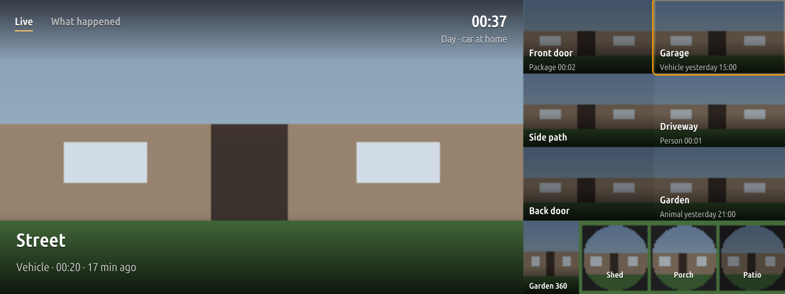
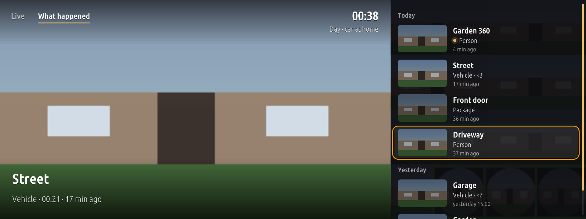
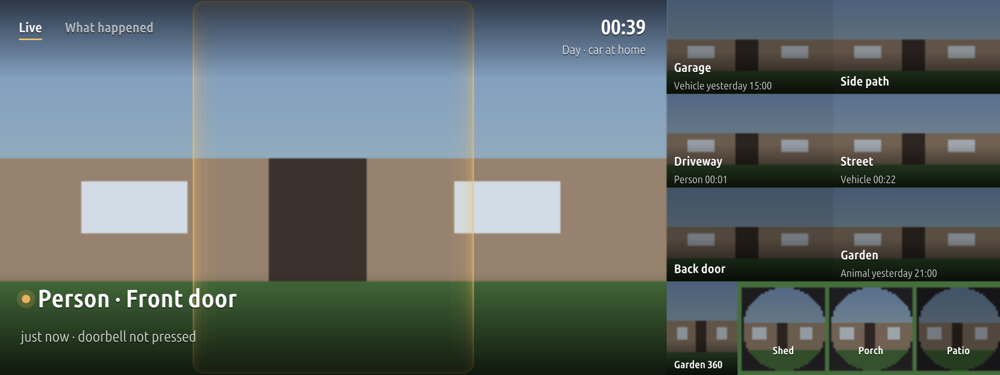

# RideWatch

Use at your own risk. RideWatch is an independent project, not affiliated with or endorsed by BMW or Ubiquiti; their
names are their owners' trademarks and are used only to say what RideWatch works with. By default it shows the
cameras only while the car is parked.

Your UniFi Protect cameras on the centre screen of a BMW with iDrive 7 (MGU). One camera is shown big on the left
and the others in a pane on the right, all live. When something happens (a ring at the door, a person, a car, an
animal, a parcel) that camera takes the big picture. A second tab lists what happened over the last days, with a
thumbnail per detection, and plays its clip from Protect.


*The live view. The pictures here are drawn by a test stub, not real cameras.*


*What happened: tap a row to play its clip.*


*A person at the door camera takes over the big picture.*

The car does not talk to Protect. A small server on your home network (any Linux machine with ffmpeg) reads the
cameras over RTSPS, composes them into one H.264 stream at exactly the size of the car's screen, and keeps the list
of detections. The car reaches that server through a tunnel, normally Tailscale.

## Works with

- UniFi Protect cameras get everything: the server finds them and their RTSPS channels by itself, and the car has
  the live view, the "What happened" list and each detection's clip.
- Any other RTSP or RTSPS camera works for the live view. Add it by hand to the server's `cams.json`, with the
  stream's address as its channel's `"url"`, for example
  `{"name": "Gate", "label": "Gate", "channels": [{"id": 1, "w": 1920, "h": 1080, "fps": 25, "url": "rtsp://..."}]}`.
  `configure.py` only knows Protect: it needs a console, and it drops the cameras Protect does not list, so add
  them again after running it.
- Detections from a camera that is not in Protect reach the "What happened" list only through the Home Assistant
  hook (see [Where the detections come from](#where-the-detections-come-from)).
- Clips come from Protect's recordings only: a camera that is not in Protect has none.

## What you need

- An iDrive 7 car (MGU, ID7 HMI) with the [MGU Store](https://github.com/robertnisipeanu/mgu-store) installed, and
  from the Store: mgu-render (0.6.8 or newer) and mgu-uplink, so that the car has a network.
- A UniFi Protect console (UniFi OS) with your cameras (for other cameras, see [Works with](#works-with)).
- A Linux machine at home that stays on: Debian or Ubuntu with systemd, Python 3.7 or newer, ffmpeg with libx264.
  It encodes one 1920 x 720 stream per car, so give it a few CPU cores (a small x86 box or a VM is fine).
- A way for the car to reach that machine. The usual one is Tailscale: the `jap-tailscale` tool from
  [mgu-apps](https://github.com/JustAnotherPU/mgu-apps) gives the car a SOCKS5 proxy into your tailnet, and the
  server machine is on the tailnet too (or behind a subnet router).

## Install the server

1. In Protect, make a local user with the View Only role (Protect, Settings, Admins and Users). The server only
   reads with it.
2. In Protect, turn on RTSPS for each camera (camera, Settings, Advanced, RTSPS), at least for one low and one high
   quality channel. A View Only user cannot do this itself.
3. On the Linux machine, from a checkout of this repository:

   ```sh
   sudo bash server/install.sh
   ```

   It installs ffmpeg if it is missing, creates a `japridewatch` system user and `/opt/jap-ridewatch`, runs the
   selftests and then asks for the Protect address (the console, for example `192.0.2.1`), the user and its password.
4. It lists the cameras it found, and the channels that still have RTSPS off. Then it asks for the cameras' roles
   (see [Camera roles](#camera-roles)); each one can be left empty.
5. It writes `/opt/jap-ridewatch/cams.json` (mode 0600, readable by the service only) and starts the services: the
   stream on TCP port 18640 and the events service.

`sudo bash server/install.sh 100.64.0.5` listens on that address only (for example the machine's Tailscale
address) instead of every interface. Run `sudo python3 /opt/jap-ridewatch/configure.py` again whenever you add a
camera or want to change the roles; Enter keeps each answer.

Do not open port 18640 to the internet. The stream is not encrypted and the only check is the car's code (below):
keep it on your LAN and your tailnet.

## Install on the car

1. In the MGU Store, open Sources and add `JustAnotherPU/ridewatch` on the Releases channel
   (`JustAnotherPU/ridewatch:releases`).
2. Add `JustAnotherPU/mgu-apps:releases` too. It has Node.js 22 (`jap-node22`), which the RideWatch service runs on,
   and Tailscale (`jap-tailscale`).
3. Install RideWatch. The Store installs the RideWatch service (`jap-ridewatch`) and Node.js 22 first, and
   mgu-render if it is missing. Install Tailscale from mgu-apps as well, and sign it in (see the
   [mgu-apps README](https://github.com/JustAnotherPU/mgu-apps#tailscale)).
4. If the Store says a restart is pending, restart the head unit.

## Pairing the car

1. Open RideWatch, then its Settings. Set Server IP (four numbers) to the server machine's address as the car sees
   it, for example its Tailscale address `100.x.y.z`.
2. Back on the camera page, the app says the server refused this car and shows a code like `ABCD-EFGH-JKLM-NPQR`.
   The car made that code at its first start; it is kept on the head unit
   (`/var/opt/jap-ridewatch/state/server.json`, readable by the service only).
3. On the server:

   ```sh
   sudo python3 /opt/jap-ridewatch/configure.py --add-car ABCD-EFGH-JKLM-NPQR
   ```

4. The app retries by itself and the cameras appear.

`configure.py --cars` lists the cars that are let in, `--remove-car CODE` removes one.

## Settings

On the car (RideWatch, Settings):

| Setting | |
|---|---|
| Parked only | On by default. See [Driving](#driving). |
| Server IP | The RideWatch server's IPv4 address. There is no default. |
| Server port | 18640, the server's default. |
| SOCKS5 proxy port | The local proxy the service connects through: 1065 is `jap-tailscale`'s. |
| Second SOCKS5 proxy port | Tried when the first one fails (another tunnel, for example). 0: none. |
| Latitude, Longitude | Where the cameras are, to the nearest 5 degrees, east positive. Used only to switch to the night camera between sunset and sunrise. Both 0: always the day camera. |

On the server (`/opt/jap-ridewatch/cams.json`, written by `configure.py`): the Protect address and user, the cameras
and their roles, the cars' codes. Optional keys, by hand: a channel's `url` (another RTSP source for that camera,
used instead of Protect's RTSPS), and the Home Assistant keys below.

On the head unit, by hand and optional: `homeSsid` in `/var/opt/jap-ridewatch/state/server.json`, your home Wi-Fi's
name. When the car is on it, the app shows "car at home" and the garage camera is never picked by itself.

## Camera roles

Each role points to one camera, or to none:

| Role | |
|---|---|
| door | A ring, or a person seen there, takes the big picture with a gold ring around it. The doorbell is suggested. |
| garage | Left out of the automatic choice while the car is at home (you would only see your own car). |
| day | The camera shown when nothing is going on. |
| night | The same between sunset and sunrise (needs Latitude and Longitude). |

With no roles at all, the big picture goes to the camera with the latest detection, else to the first camera.
A ring without a door camera shows the camera that rang. Tapping a camera in the pane makes it the big one until
you leave the app.

## Where the detections come from

By default the events service asks Protect for its event list every 3 seconds, with the same View Only user. It
keeps rings and smart detections (person, vehicle, animal, package) and leaves plain motion out. When Protect
cannot be reached or refuses the login, it waits longer between tries (up to 5 minutes), so a wrong password does
not lock the user out.

Home Assistant can send the detections instead, or as well: `examples/home-assistant.yaml` has the
`rest_command` and the automation. Add `"events_from": "<Home Assistant's IP>"` and
`"events_token": "<a long random string>"` to `cams.json`, and `"events_protect": false` to stop asking Protect,
then `sudo systemctl restart jap-ridewatch-events`.

## Driving

The cameras are shown only while the car is parked, by default. Above 3 km/h the picture stops, and if the car's
speed cannot be read the car counts as moving.

Parked only can be turned off in the settings. Then the cameras keep playing while the car moves. That is for
passengers only: the driver must never watch the screen. You use it at your own risk; check that it is legal where
you drive. Unlike Moonride, RideWatch does not ask you to accept a disclaimer before turning it off.

### No warranty

RideWatch is free software, provided "as is", without warranty of any kind, to the extent permitted by applicable
law. In no event will the authors be liable for damages arising from its use. See sections 15 (Disclaimer of
Warranty) and 16 (Limitation of Liability) of the GNU General Public License v3 in `LICENSE`.

## Security

- The stream between the server and the car is plain H.264 over TCP, and the car's code travels in clear in the
  first line. Over Tailscale the whole link is encrypted; on any other network it is not.
- The server talks to the Protect console over HTTPS without checking its certificate (the console's own
  certificate is self-signed). Run the server on the same LAN as the console.
- `cams.json` holds the Protect user's password. It is mode 0600 and owned by `japridewatch`; use a View Only user.
- The RideWatch service's control socket (`/run/jap-ridewatch/ctl.sock`) is open to every app on the head unit (they all
  share one group). Install only apps you trust.

## Known limits

- iDrive 7 (ID7) only. The server and the tunnel were measured from one car; the app, the service and the decoder
  are checked by offline tests, and their CPU and decode times on the head unit are not measured yet.
- Protect's API is private and changes between versions. The login, the RTSPS streams and the export used for
  clips were tested with one console. The camera list (`/proxy/protect/api/cameras`, read by `configure.py`) and
  the event list (`/proxy/protect/api/events`, the default source of detections) are new in this release and were
  tested only against a fake Protect, not a real console. If the timeline stays
  empty, look at `journalctl -u jap-ridewatch-events` and use the Home Assistant source meanwhile.
- A camera with RTSPS off is left out. A clip is first exported from Protect (HEVC), then re-encoded to H.264 on
  the server, so it takes a few seconds to start.
- One server stream per car; several cars at once each cost one encoder on the server.
- The video is decoded in hardware (Intel Media SDK). Popups and the reversing camera cover it.

## Uninstall

1. In the MGU Store, uninstall RideWatch, then the RideWatch service (`jap-ridewatch`). Node.js 22 and Tailscale
   stay for other apps.
2. On the server, remove the car's code (`configure.py --remove-car CODE`), or the whole server:
   `sudo systemctl disable --now jap-ridewatch.socket jap-ridewatch-events.service`, then
   `sudo rm -r /opt/jap-ridewatch /var/lib/jap-ridewatch /etc/systemd/system/jap-ridewatch*` and
   `sudo userdel japridewatch`.

## Repository layout

| Path | |
|---|---|
| `apps/jap_ridewatch`, `test/app` | the app (Node 8, on the head unit), built with the kit, and its tests |
| `kit/` | the app kit (build script and runtime) |
| `daemon/` | `ridewatchd.js`, the service (Node 22): the stream and events from the server, the choice of the big camera |
| `native/camdec` | the H.264 decoder (C++, Intel Media SDK) writing into mgu-render's video layer |
| `tools/jap-ridewatch` | the service's tool: manifest, unit, build script |
| `server/` | the RideWatch server: `serve.py` (stream, clips), `events.py`, `configure.py`, `install.sh`, systemd units |
| `examples/` | Home Assistant as a source of detections |
| `release/` | makes the Store release (`catalog.json` and the artifacts) |

## Building

You need Docker (on a Mac: colima; set `TMPDIR` to a folder outside `/var/folders`), Python 3, Node.js, and a
checkout of the [MGU Store](https://github.com/robertnisipeanu/mgu-store) for its packer (`MGU_STORE=<path>`).
BMW's oap-sdk is never part of this repository or of a release. To build or test the app you need your own copy,
extracted from your head unit with `kit/tools/extract_sdk.js`, in `./oap-sdk`.

```sh
python3 kit/tools/build.py jap_ridewatch              # the app: dist/jap_ridewatch@<version>.tgz
make -C native/camdec target                     # the decoder (x86_64, glibc 2.27)
sh tools/jap-ridewatch/build.sh                       # the tool artifact, in dist/
sh release/release.sh                            # dist/release/: catalog.json + artifacts (no oap-sdk)
```

Tests:

```sh
# the app against a fake service and renderer, on Node 8 (the head unit's)
docker run --rm --network none -v "$PWD:/w" -w /w node:8.16.0-alpine \
  sh -c 'mkdir -p /tmp/t && node test/app/smoke.js dist/jap_ridewatch /tmp/t && node test/app/frame_test.js'
# the service, on Node 22
docker run --rm --network none -v "$PWD/daemon:/w" -w /w node:22-alpine node test/ridewatchd_test.js
# the decoder: unit tests and a smoke test on the host (needs ffmpeg), then the same in the target image
make -C native/camdec test target
# the server (Python 3, ffmpeg)
python3 server/serve.py --selftest && python3 server/events.py --selftest && python3 server/configure.py --selftest
```

## Releasing

Make a GitHub release named `catalog` (tag `catalog`) and upload every file of `dist/release/`: `catalog.json`,
the two `.tgz` artifacts and `jap_ridewatch.png`. The Store reads `catalog.json` from that release and checks every
download against its size and sha256. For a new version, run `release/release.sh` again and replace the release's
files.

## License

GPL-3.0-or-later (`LICENSE`). Copyright (C) 2026 JustAnotherPU. Third-party components and their licences are
listed in `THIRD_PARTY_LICENSES/`.
